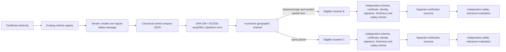

# Secure V2V Simulation Architecture

## Message flow

The API and React dashboard are a presentation layer around the existing `src/` cryptographic implementation. `SimulationState` continues to own the single vehicle registry, CA, attacker, statistics, and event log. `BroadcastService` selects recipients and passes the same packet to each receiver's existing `SecureVehicle.receive_packet()` pipeline. Each vehicle has its own replay protector.

## Packet and signature

A message contains `vehicle_id`, `timestamp` (Unix seconds), `sequence_number`, `position` (latitude/longitude in decimal degrees), `speed` (km/h), `direction` (compass heading), `event`, `message_id`, `schema_version` (currently 1), and `event_data` (object). `serialize_message()` encodes compact UTF-8 JSON with sorted keys and no whitespace. The ECDSA signature is computed over those exact bytes using SHA-256. The packet adds the DER ECDSA signature and sender X.509 certificate PEM. Private keys remain in the in-process vehicle objects and are never returned by the API.

## Channel and recipient selection

The channel is an in-process simulation, not a socket or radio implementation. It uses great-circle Haversine distance over latitude/longitude, excludes the sender, excludes offline vehicles, and logs why candidates were omitted. A configurable range is a simplified reachability boundary. Seeded packet loss is evaluated only for eligible vehicles and is independent of crypto verification. No real DSRC, IEEE 802.11p, or C-V2X behavior is claimed.

## Vehicle movement and event evaluation

`POST /api/simulation/step` advances online vehicles from speed, acceleration, and compass heading using a short-step local geographic approximation. Direct state updates are also available through `PATCH /api/vehicles/{vehicle_id}`. A message's event position is the sender's current position when the signed message is created. Safety evaluation runs only after successful security verification. TTC projects the receiver-to-event vector onto the shared forward heading (north=0°, east=90°) and divides positive distance in metres by positive receiver-minus-event speed in m/s; speeds enter in km/h and are converted by 3.6. Moving-vehicle warnings require a finite TTC no greater than 10 seconds. TTC unavailable or non-closing motion does not create a moving-vehicle warning; nearby road/accident hazards use the configured distance threshold. The model is for education and is not suitable for vehicle control.

## API summary

- `GET /api/vehicles`, `POST /api/vehicles`, `PATCH /api/vehicles/{vehicle_id}`: list, create, or update registered simulated vehicles.
- `GET /api/simulation/config`, `PUT /api/simulation/config`, `POST /api/simulation/step`: simulation settings and deterministic movement.
- `POST /api/message/send`: existing sender-selected unicast.
- `POST /api/message/broadcast`: broadcast one signed packet to candidates and return per-vehicle outcomes.
- `GET /api/status`, `/api/certificates`, `/api/certificates/{vehicle_id}`, `/api/events`, `/api/performance`, `/api/architecture`: dashboard data.
- `POST /api/attack/replay`, `/api/attack/tampering`, `/api/attack/impersonation`, `/api/attack/fake-certificate`, `/api/attack/stale`, `/api/attack/false-data`: local educational attacks.
- `DELETE /api/events`, `POST /api/performance/run`: event log and existing benchmark operations.

The FastAPI OpenAPI schema at `/docs` is the canonical detailed request/response schema.

## Benchmark timing definitions

`scripts/benchmark_broadcast.py` reports averages after one warm-up send. Message creation is the call that creates the schema fields and increments the sender sequence; signing includes canonical serialization/hash and ECDSA signing. Eligibility includes candidate status/position checks and the single Haversine distance calculation per candidate. Delivery processing covers packet-loss draws, delivery, the receiver pipeline, and safety evaluation for each recipient. Per-recipient verification is the receiver's schema/certificate/identity/signature/freshness/replay pipeline, measured separately from safety evaluation. Total broadcast is the sum of message creation, signing, eligibility, and delivery processing; it excludes HTTP transport, frontend rendering, and real network latency.
